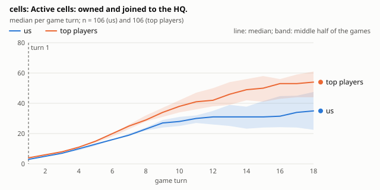
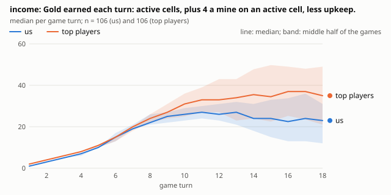
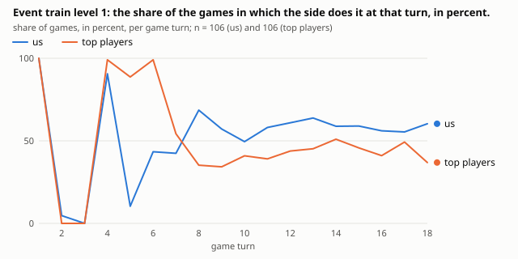
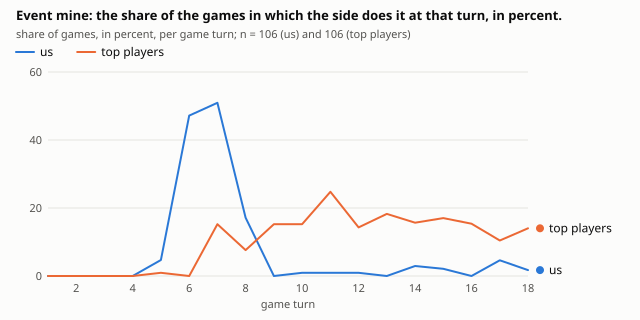
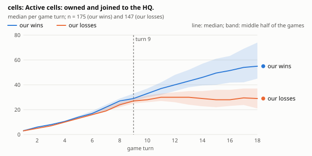
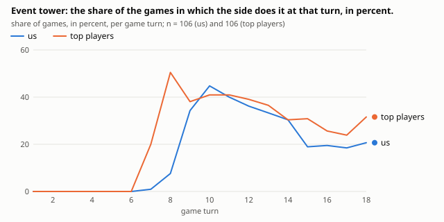
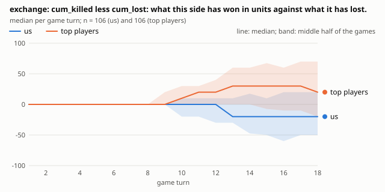

# ice-and-fire-v014 against the top 10 of CodinGame

> **Correction, 2026-11-11.** Sections 1, 2 and 7 compare the top players with us in the same games, where they play second and we play first. The second player starts with one more cell, and the opening differences reported here (more cells from turn 1, trainings at turn 5, first contact a turn earlier) come mostly from the seat, not from the players: as second player we train at turn 5 too. Of the 6-cell gap at turn 8, about four come from the seat and the rest from our early mine, so the first experiment's target ("close the 6-cell gap") does not stand as written. What holds, within a seat: our early mine, the top players' mines in the middle game, their cuts and their exchanges. See [the report of 2026-11-11](2026-11-11-v014-against-the-top-10.md), on 2,177 games, which compares within a seat.

What it covers: 322 games of `ice-and-fire-v014` (our nickname is Tarleya), kept on the branch `claude/codingame-games` (commit ac331ba): the 222 ranking games its submission played on 2026-10-31 against Legend players, and 100 test games against the top 10 of the leaderboard on 2026-11-06, 10 against each on the 10 fixed maps of `games/ice-and-fire/codingame-seeds.txt` (our bot is always player 0, red, in test games). Ranks come from the leaderboard of 2026-11-06, 16:51 UTC. All 322 games were replayed by our engine and agree with CodinGame, command by command.

Written by Claude from the generated charts and data (section "Data" below, and `signals.md` there). Curves show the median of each side, read right after its own play of the turn, with a band for the middle half of the games. Turn numbers are game turns; games against the top 10 last 16 to 20 turns (median by opponent).

## The result: the top 10 are a level above us

v014 won 20 of its 106 games against the top 10 (100 test games and 6 ranking games), against 61 of 106 for ranks 11 to 30 and 61 of 75 below. Only aCat (#10: we won 5 of 13) and Waffle3z (#7: 4 of 11) are within reach; we won 0 of 10 against karliso (#3) and 1 of 10 against zasmu, Pduhard-, _iahelka and Zylo.

## 1. The gap opens at turn 5, in the opening, not in the fights

The top bots hold more cells from turn 1 (4 against our 3), and the gap never shrinks, widening from turn 5: 15 against 13 at turn 5, 29 against 23 at turn 8, 38 against 28 at turn 10, 50 against 31 at turn 15. Their income stays close to ours until turn 8 (24 against 22), then pulls away: 31 against 26 at turn 10, 34.5 against 24 at turn 15, while ours stops growing.





## 2. Why: at turns 5 and 6 they train, we build a mine

Both sides save at turns 2 and 3 and train at turn 4. Then the paths split. At turn 5, 89% of the top bots' games train level-1 units, against 10% of ours; at turn 6 nearly all of theirs train again. We spend turn 6 on a mine instead: 47% of our games build one at turn 6, none of theirs. Over the early game they spend 7.9 gold a turn on level-1 units and 0.4 on mines; we spend 5.6 and 2.5. The mine pays 4 gold a turn; the units they train take cells that pay 1 each, block our growth and fight for the land between the HQs: by turn 8 they are 6 cells ahead and never give them back.





Our own games say the same: in our wins, 53% of games train at turn 5, against 27% in our losses.

## 3. What decides our games: land from turn 9

Of every metric, active cells and the land nearer to us than to the enemy (`voronoi`) tell our wins from our losses best, from turn 9 on: at turn 15 we hold 49.5 cells in our wins and 28 in our losses, and that difference alone sorts 91% of pairs (one win, one loss) the right way. Material follows from turn 10.



## 4. The middle game: they invest, we keep gold

Once their territory is large, the top bots turn their income into income and protection: in the middle game they spend 2.9 gold a turn on mines (we: 0.1), 7.5 on towers (we: 5.1) and 4.9 on level-2 units (we: 2.4), while we spend more on level-1 units (11.0 against 6.3); half of their games build a tower at turn 8, against 8% of ours. In the same games, they keep 38% of their gold unspent at the end of a middle-game turn and we keep 52%; across all our games, 46% in our wins and 57% in our losses. At turn 10 we hold 22 gold against their 9.



## 5. How they finish: a large cut around turns 12 to 14

A large cut of our territory decides 101 of our 147 losses (median turn 13 against the top 10), an HQ threat 35 (around turn 17), debt 4. Before a cut by a top player, we are about as open as in our wins at the same turn (5 cells or more that 30 gold could take from us: 31% of these losses against 25% of wins), and only rarely very open (10 cells or more: 5.5% against 2%): we are not unusually exposed; we are smaller, with fewer and weaker units, so the same exposure costs us the game. Against weaker players, very open positions matter more (10 cells or more: 13% of losses against 3% of wins) (decisive moments: the folder `2026-11-06-v014-decisive-moments/` of pull request #285).

## 6. Our search disagrees with their moves

At each turn of a top bot, our search would play the same plan only 4 to 12% of the time, and in undecided positions it scores their plan below its own by a median of 6 (aCat) to 20 (zasmu) gold, by more than 20 gold on 31% to 49% of their turns. Since they win, the likely reading is that our evaluation underrates their plans; the largest gaps (`2026-11-06-v014-judge/largest-gaps.md`, in the folder of pull request #287) are the place to look for what it misses.

## 7. Economy or fighting? Both, and the economy comes first

The top bots win the fights too. The exchange (the training cost of the enemy units a side removed, less that of its own it lost) is close until turn 10 (+10 for them, 0 for us), then turns: at turn 15 it stands at +30 for the top players and -20 for us; in our own games, +30 in our wins and -30 in our losses. They get more for their army: 0.50 of enemy value removed per gold spent on units, against our 0.36.



But the fights follow the opening's choice. In the early game they put 92% of their spending into units and 5% into mines; we put 69% into units and 31% into mines. They reach the fights with more units and more land (both sides first touch at turn 7 or 8; the one-turn difference in our numbers comes from reading each side after its own ply, since we play first in almost all these games). Their economy per gold is only a little better (0.21 cells gained per gold spent at turn 15, against our 0.19), and upkeep eats the same share of income on both sides (29% and 27%): they are not cheaper, they are bigger and earlier. In the middle game they spend more on towers and mines (33% and 13%, against our 26% and 1%), and we keep spending on units (73%, against their 54%).

A lead is decisive early: ahead in material at turn 10 by more than 57 (about six level-1 units' worth), we won 48 of 50 games; behind by more than 57, 24 of 107; at turn 15, ahead or behind by more than 187, 55 of 57 and 0 of 66. So the holdings built in the opening (material: gold, income, cells, army and towers), more than any later fight, decide most games.

## What to try in our bot

One experiment each, judged by the SPRT as usual:

1. **Opening: train at turns 5 and 6 instead of building the first mine.** The strongest signal of this report: it is in the top bots' play, in their spending mix (92% on units in the early game, against our 69%) and in our own wins; and a lead at turn 10 wins nearly every game. Measure the cells at turn 8 (target: close the 6-cell gap).
2. **Middle game: spend.** Mines once the territory is large (turn 10 or later), level-2 units and towers at the front from turn 8, and less gold left unspent.
3. **Evaluation:** check, on the judge's largest gaps, which terms make our search prefer its plan to the top bot's; the land (`voronoi`) and the cells beyond our reach are the first suspects.

## Limits

10 games against each top bot, on 10 maps, always as player 0 in the test games; their bots may change (the daily collection of ADR 0057 records each opponent's version). Differences of a few units are within the noise of 10 games; the gaps above (cells, income, turn-5 trainings, mines, towers, gold kept) are large and the same across the ten bots.

## Data

The numbers, charts and findings behind this report are in the folder [2026-11-06-v014-against-the-top-10/](2026-11-06-v014-against-the-top-10/):

- [README.md](2026-11-06-v014-against-the-top-10/README.md): every file and its columns;
- [signals.md](2026-11-06-v014-against-the-top-10/signals.md): the strongest findings, picked by code, each with its chart and data file;
- the tables as CSV: [sources](2026-11-06-v014-against-the-top-10/sources.csv), [opponents](2026-11-06-v014-against-the-top-10/opponents.csv), [profile metrics at turns](2026-11-06-v014-against-the-top-10/profile_metrics_turn.csv) and [by phase](2026-11-06-v014-against-the-top-10/profile_metrics_phase.csv), [events](2026-11-06-v014-against-the-top-10/profile_events.csv), [moments](2026-11-06-v014-against-the-top-10/profile_moments.csv), [openings](2026-11-06-v014-against-the-top-10/profile_openings.csv), [wins](2026-11-06-v014-against-the-top-10/profile_wins.csv), [our weaknesses](2026-11-06-v014-against-the-top-10/weaknesses_stays_below.csv), [the AUC by turn](2026-11-06-v014-against-the-top-10/separation.csv), [spending](2026-11-06-v014-against-the-top-10/spending.csv), [games](2026-11-06-v014-against-the-top-10/games.csv), [versions of the players](2026-11-06-v014-against-the-top-10/profile_versions.csv) and [their agent ids by day](2026-11-06-v014-against-the-top-10/versions.csv);
- economy or fighting: [exchange of units](2026-11-06-v014-against-the-top-10/economy_exchange.csv), [efficiency](2026-11-06-v014-against-the-top-10/economy_efficiency.csv), [investment mix](2026-11-06-v014-against-the-top-10/economy_mix.csv), [upkeep burden](2026-11-06-v014-against-the-top-10/economy_upkeep.csv), [tempo](2026-11-06-v014-against-the-top-10/economy_tempo.csv), [the value of a lead](2026-11-06-v014-against-the-top-10/economy_lead.csv) and [the curves by turn](2026-11-06-v014-against-the-top-10/economy_curves.csv), with 12 charts (`economy-top-vs-us-*`, `economy-wins-vs-losses-*`), for example [the exchange, top players against us](2026-11-06-v014-against-the-top-10/economy-top-vs-us-exchange.svg);
- every metric and event turn by turn: [all top players](2026-11-06-v014-against-the-top-10/turns-all-top-players.csv), [our wins](2026-11-06-v014-against-the-top-10/turns-our-wins.csv), [our losses](2026-11-06-v014-against-the-top-10/turns-our-losses.csv) and one file for each top player (`turns-NAME.csv`);
- 74 SVG charts (`top-vs-us-*`, `wins-vs-losses-*`, `player-NAME-*`, `economy-*`), for example [income, our wins against our losses](2026-11-06-v014-against-the-top-10/wins-vs-losses-income.svg).

Made by (about 6 seconds on 4 cores), from a worktree of the data branch:

```sh
ice-and-fire-review codingame-report --data <claude/codingame-games>/ice-and-fire --me Tarleya --out games/ice-and-fire/research/codingame/2026-11-06-v014-against-the-top-10
```
