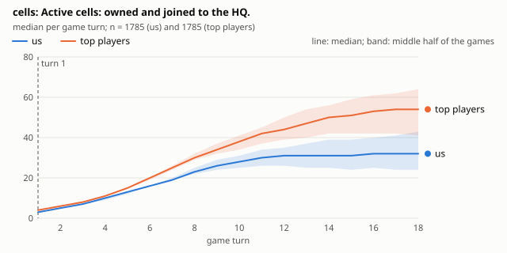
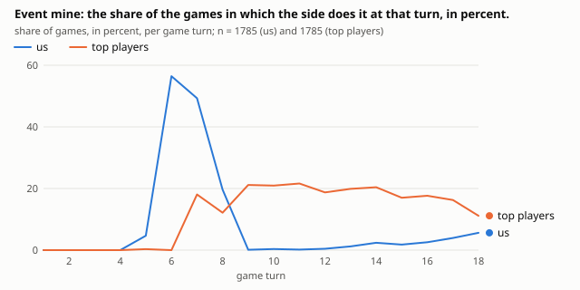
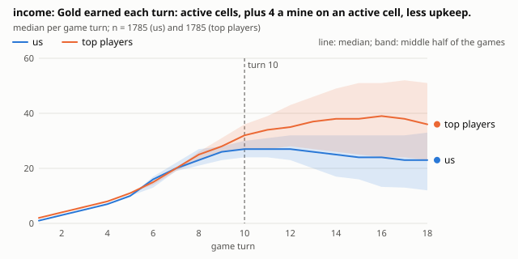
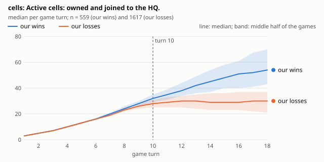
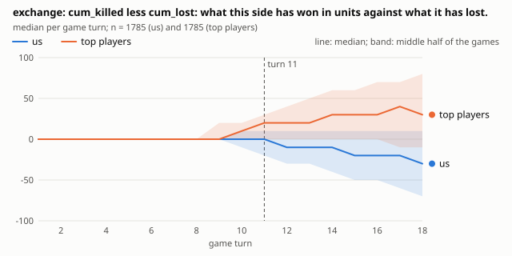

# ice-and-fire-v014 against the top 10 of CodinGame: 2,177 games

What it covers: every game of `ice-and-fire-v014` (our nickname is Tarleya) on the branch `claude/codingame-games` at commit 7030bce: 1,950 test games against the top 10 of the leaderboard, played from 2026-11-06 to 2026-11-11 (about 195 against each, on 50 fixed maps, by the daily collection of ADR 0058), and the 227 ranking games of its submission. In test games our bot is always the first player (red). All games were replayed by our engine; 2,176 agree with CodinGame command by command, and one is left out (game 919644599: the opponent sent 20 refused commands in one turn and CodinGame's log lists 18 of them; the game itself replays alike).

Written by Claude from the generated charts and data (section "Data"). Curves show the median of each side, read right after its own play of the turn, with a band for the middle half of the games. Turn numbers are game turns; games against the top 10 last 17 to 22 turns (median by opponent).

**This report corrects the one of 2026-11-06.** That report compared the top players with us in the same games, where they play second and we play first. The two seats do not start alike (section 1), and most of the opening differences it reported (more cells from turn 1, trainings at turn 5, first contact a turn earlier) come from the seat, not from the players. The comparisons below are made within one seat.

## The result

v014 won 403 of its 1,950 test games against the top 10 (21%), the same every day (20% to 22%). No top-10 player changed its bot during the six days (same agent ids in every leaderboard snapshot).

| Player (rank on 2026-11-11) | We won | How it plays against us, per game | Its wins start with |
|---|---:|---|---|
| zasmu (1) | 10 of 196 (5%) | 17.6 towers (ours: 3.2), 3.4 mines; income 49 at turn 15 | a swing (54%, turn 15), an HQ threat (27%, turn 18) |
| Pduhard- (2) | 24 of 196 (12%) | no mines, 2.6 level-3 units (ours: 1.0); 50 cells at turn 15 | a swing (48%) or a large cut (47%), turns 12 to 13 |
| karliso (3) | 11 of 194 (6%) | 4.6 mines, 6.1 towers; income 48 at turn 15 | a large cut (48%, turn 13) |
| _iaz (4) | 43 of 195 (22%) | 3.6 level-2 units (ours: 1.3); 56 cells at turn 15 | a swing (55%, turn 12) |
| reCurse (5) | 49 of 195 (25%) | 3.7 mines; income 43 at turn 15 | a swing (43%) or a large cut (33%), turn 13 |
| _iahelka (6) | 25 of 195 (13%) | 56 cells at turn 15 | a large cut (56%, turn 11, the earliest) |
| Waffle3z (7) | 45 of 196 (23%) | 3.9 mines, 3.8 level-2 units; income 46 at turn 15 | a swing (62%, turn 12) |
| Zylo (8) | 39 of 195 (20%) | 8.0 towers, 4.8 level-2 units | a swing (62%, turn 13) |
| N3l (9, new in the top 10) | 8 of 27 | 4.1 mines, 4.7 level-2 units | (27 games only) |
| NinjaDoggy (10) | 54 of 196 (28%) | no mines, 6.6 towers | a large cut (50%, turn 13) |

The counts include the few ranking games against these players (N3l: 7 of its 27 games). aCat, tenth when the collection started and twelfth now, is the one we hold: 96 won of 177 (54%). A "swing" is a turn in which the lead in holdings moves by 60 or more; a "large cut" takes 30% or more of our cells at once.

## 1. The seat matters, and test games give us the worse one

On these maps the second player (blue) starts with two cells and the first (red) with one. Blue is one cell ahead after turn 1 and about four at turn 8 for players other than us (the rest of Legend holds 30 cells as blue and 26 as red); for us the gap between the seats is six (29 as blue, 23 as red), the extra coming from our early mine (section 2). The top 10 as blue hold 30 at turn 8, like everyone else in that seat. In our 227 ranking games the first player won 100 (44%); we won 68 of 106 as red (64%) and 89 of 121 as blue (74%).

CodinGame's test games always make the tested bot the first player. So our 21% against the top 10 is measured in the worse seat, and any chart of "top players against us" from these games carries the seat's head start.



## 2. The opening: everyone plays alike, except our early mine

Within a seat, the first eight turns look the same for the top 10, the rest of Legend and us: train at turns 1 and 4, then every turn a blue player can afford (all of our own games as blue train at turn 5, like 99% of the top 10's; a red player cannot afford it: 6% to 11% for everyone).

One thing is ours alone: the first mine. As red we build it at turn 6 in 57% to 64% of games (the rest of Legend as red: 6%) and train at turn 6 in 35% to 41% (they: 93%). As blue we build it at turn 7 in 46% of games (the top 10 and the rest of Legend: 16% to 18%). By turn 8 it costs us about three cells as red (23 against 26) and one as blue (29 against 30), and gives two more gold of income (23 against 21 as red).

The games do not say whether that trade is good. Against the top 10 we won 22% of the games with an early mine and 13% of those without, but whether we build it depends on the map, and the maps differ far more than that (section 8). It needs an experiment.

## 3. The middle game: where the top 10 leave the rest of Legend behind

Against the same opponent (us, as red) and in the same seat (blue), the top 10 and the rest of Legend are level until turn 10. Then:

| Median, as blue against us | Turn 10 | Turn 12 | Turn 15 |
|---|---:|---:|---:|
| Cells: top 10 | 38 | 44 | 51 |
| Cells: rest of Legend | 36 | 40 | 41.5 |
| Income: top 10 | 32 | 35 | 38 |
| Income: rest of Legend | 28 | 29 | 23 |
| Mines held: top 10 | 0 | 1 | 2 |
| Mines held: rest of Legend | 0 | 0 | 0 |

The top 10 keep growing; the others stall and their income falls as the fights cost them. One caution: the top 10 are measured in the test games (the 50 fixed maps) and the rest of Legend in our ranking games (other maps, another day), so part of the difference may come from the maps.

One habit goes with it, mines in the middle game: from turn 9 to turn 15 the top 10 build a mine in about 20% of games every turn, the rest of Legend in 6% to 9%, and we almost never (0% to 2% against the top 10; 4% to 9% at turns 13 to 15 in our ranking games): our bot builds its mine early and then stops (under 1% of our spending goes to the economy in the middle game, against 14% of theirs). The top 10 are already 2 cells and 4 gold of income ahead of the rest of Legend at turn 10, before their mines show, so the mines may follow their lead as much as make it. Level-2 units and towers come at the same rate for the top 10 and the rest of Legend (from turn 9, a level-2 unit in 20% to 26% of games a turn for the top 10 and 15% to 30% for the others, a tower in about 40% for both); we train level-2 units about half as often (12% to 16%) and start towers a turn later (15% of games at turn 8, against 42% to 48%).

Against the top 10, our own cells stop at 31 from turn 12 and our income falls from 27 to 24.





## 4. What decides our games: land from turn 10, and a lead is nearly final

Cells and the land nearer to us than to the enemy (`voronoi`) tell our wins from our losses best, from turn 10 on: at turn 15 we hold 48 cells in our wins and 29 in our losses (that alone sorts 89% of win-loss pairs).

A lead in holdings (`material`) is worth this much in our games: ahead by more than 64 at turn 10 (about six level-1 units' worth), we won 92 of 101; behind by more than 64, 65 of 954. At turn 15, ahead by more than 196, 184 of 185; behind by more than 196, 5 of 729.



## 5. How they finish

Of our 1,477 losses to the players of the current top 10, a large cut of our territory decides 874 (59%, median turn 14), a threat on our HQ 469 (32%, turn 18), debt 75 (5%, turn 18); 59 have no such moment.

Before a deciding cut we are more open than in our wins at the same turn, but not by much: 34% of these losses had 5 or more cells that 30 gold could take from us, against 20% of wins; 6.5% had 10 or more, against 2.2%. Two losses in three are cut with fewer than 5 cells exposed: the cut comes from their size more than from our shape.

They make more of these cuts than the rest of Legend does: from turn 11 to turn 15 the top 10 make a large cut in 7% to 12% of games every turn, the others in 2% to 4% most turns.

## 6. Fighting: they win the exchanges, a little better than the rest of Legend

At turn 15 the top 10 have removed 90 gold of our units and lost 60 (exchange +30); the rest of Legend, in the same seat against us, removed 65 and lost 60. We stand at -20 against the top 10 and level against the others. Per gold spent on units, and within one seat (blue), the top 10 remove 0.53 of enemy value, the rest of Legend 0.40 and we 0.39.



## 7. What our search thinks of their moves

At each of 34,283 turns of the top 10, our search (600 tries) chose its own plan and scored the plan they played. It plays the same plan in 7% of turns and the same first command in 12% more. In undecided positions it scores their plan a median of 14 gold below its own.

Where it disagrees most says what our evaluation undervalues. In the early game the gap is small (4 gold: we agree on the opening). In the middle game their plain turns (moves and level-1 trainings) score 22 below ours, their turns with a tower 27, with a level-2 unit 29, with a mine 35, and with a level-3 unit 109. So our search sees little value in the two things the top 10 do and we do not: mines in the middle game and level-3 units. Against zasmu the gap is the widest (median 30, above 20 gold on 56% of its turns).

## 8. The map matters a great deal

On the 45 maps with 20 games or more, our win rate against the top 10 goes from 0% (0 of 30 on one map, 0 of 40 on another) to 53% (21 of 40), with a median of 20%; chance alone would spread it by about 7 points. What makes a map good or bad for us is not analysed here.

## What to try in our bot

One experiment each, judged by the SPRT as usual; the order is by the strength of the evidence.

1. **Mines in the middle game.** Let the search build mines from turn 9 when the territory is large: the top 10 do it two to three times as often as the rest of Legend, we almost never do, and our search scores their mine turns 13 gold below their plain turns. The games show that it goes with their lead, not that it makes it.
2. **Level-3 and level-2 units.** Look at how the evaluation counts stronger units, on the judge's largest gaps (`2026-11-11-v014-judge/largest-gaps.md`): the top 10's level-3 turns score 109 below our own choice, and we train level-2 units half as often as everyone else.
3. **The first mine.** Try trainings instead of the early mine (turn 6 as red, turn 7 as blue), as everyone else plays; our games do not settle whether it helps.
4. **The first tower** a turn earlier (turn 8), as the top 10 and the rest of Legend build it.
5. **The worst maps:** read the games on the maps where we win 0% to 3%.

## Limits

- The seat: all test games are played as red. How the top 10 play as red, and how we do against them as blue, is seen in a handful of ranking games only.
- The "rest of Legend" comparison rests on our 227 ranking games (106 as red, 121 as blue), against players ranked 9 to 100 and a few unranked ones (a handful of these games are against top-10 players), on other maps than the test games: medians of about 100 games.
- 50 maps, the same every day; one release (v014); six days.
- The judge compares plans by our own evaluation: a large gap shows a disagreement, and since they win, probably our error, but not which term is wrong.

## Data

- [2026-11-11-v014-against-the-top-10/](2026-11-11-v014-against-the-top-10/): the tables as CSV, every metric and event turn by turn, 74 charts, [signals.md](2026-11-11-v014-against-the-top-10/signals.md) (the strongest differences found by code) and a [README.md](2026-11-11-v014-against-the-top-10/README.md) of the files. Its "top players against us" sets mix the seats as the games do (section 1).
- [2026-11-11-v014-decisive-moments/](2026-11-11-v014-decisive-moments/): `summary.csv`, `examples.md` (boards before and after, per top player), `README.md`, and `moments-losses.csv`, the loss rows of the generated `moments.csv` (its 608,162 control rows, 51 MB, are not committed).
- [2026-11-11-v014-judge/](2026-11-11-v014-judge/): `summary.csv`, `largest-gaps.md`, `README.md` (the per-turn `judgements.csv`, 34,283 rows and 6 MB, is not committed).

Made from a worktree of the data branch at 7030bce (`DATA` is its `ice-and-fire` folder; about 20 seconds for the report, 18 for the moments and 2.5 minutes for the judge on 4 cores):

```sh
ice-and-fire-review codingame-report --data DATA --me Tarleya --out 2026-11-11-v014-against-the-top-10
ice-and-fire-review codingame-moments --data DATA --me Tarleya --out 2026-11-11-v014-decisive-moments
ice-and-fire-review codingame-judge --data DATA --me Tarleya --judge target/release/ice-and-fire-bot-plan --out 2026-11-11-v014-judge
# The seat-matched numbers of sections 1 to 3 and 6 (turns-all-top-players.csv of each folder):
ice-and-fire-review codingame-report --data DATA --me Tarleya --kinds test --out top10-as-blue
ice-and-fire-review codingame-report --data DATA --me Tarleya --kinds ranking --our-seat 0 --top 100 --out legend-as-blue
ice-and-fire-review codingame-report --data DATA --me Tarleya --kinds ranking --our-seat 1 --top 100 --out us-as-blue
```

The numbers of section 7 by kind of turn, of section 8 and of the early mine in section 2 were counted from `judgements.csv` and from the logs.
